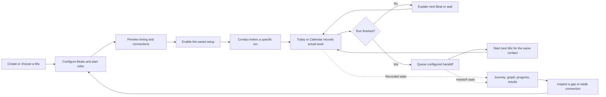

# Journey experience: forensic review and interaction contract

**Implementation follow-up:** see [the implementation and verification record](JOURNEY_IMPLEMENTATION_2026-09-21.md) for delivered behavior and tested limits. The analysis below records the earlier evaluation and recommendations.

September 21, 2026. This extends the [Mix/Beat graph proposal](MIX_HANDOFF_AND_JOURNEY_PROPOSAL_2026-09-21.md) following the owner's request to examine the experience throughout the platform.

**Further owner clarification:** multiple triggers, concurrent Mixes/Beats, conditional paths and loops are core requirements. The estimate scenario is strictly an example; all implemented topology and outcomes must derive from each account's actual configuration. The [dynamic workflow contract](JOURNEY_DYNAMIC_WORKFLOW_CONTRACT_2026-09-21.md) extends this review with instance correlation, configurable decisions, joins, return visits and interruption rules. The combined register contains 32 findings and the acceptance matrix contains 96 planned scenarios.

**Scope and evidence:** source-level tracing of the current local application, prior design decisions, and 61 existing tests across 12 suites on a newly created disposable PostgreSQL cluster. The cluster and its test database were removed afterward. No application code, production data, schema or deployment changed. The proposed graph and handoff system do not yet exist, so this is a design and implementation-readiness evaluation, not a browser usability certification. Proposed behavior below is identified separately from verified current behavior; passing baseline tests does not qualify the future feature.

## Assessment

The concept works if Journey becomes the shared explanation of what the product actually does. Mixes configure the plan; Today handles due work; Contacts explains an individual's progress; Calendar supplies appointment anchors; Journey connects those views. Users must not maintain a second diagram or repeat a contact assignment when a configured handoff occurs.

The highest-risk gaps are semantic, not diagram layout: what starts a run, what finishes it, which edits affect existing people, what pause/resume means, and what recorded evidence supports “strong” or “weak.” Those contracts must be shared before adding live status to the graph.

Five requirements govern every interaction:

1. Every displayed connection corresponds to a saved, supported rule, or is explicitly an unsaved preview.
2. Every displayed status explains the same run/Beat/handoff across Journey, Today, Contacts and Calendar.
3. Normal configured progression requires no additional user action. Exceptions explain the reason and offer one relevant repair.
4. No contacts disappear because a node is collapsed, a definition is archived internally, or a worker has not prepared a Jump yet.
5. Activity, progression and customer success are measured separately. No-data and waiting states cannot masquerade as poor results.

## 1. The complete user flow

This diagram describes the proposed operator workflow. The actual Journey canvas depicts the user's own Mixes and Beats, not these generic process steps or fixed CRM stages.

### First visit and first useful setup

A new account can begin with one person and one Mix through the existing onboarding flow. Journey immediately shows that actual Mix, its Beats and its entry condition. No stage configuration, pipeline naming, import quota or drawing exercise is required. With no Mixes, show Create Mix and Choose ready-made; with Mixes but no contacts, show the real setup with zero traffic and a conditional preview. Never seed a fictional live pipeline.

Existing users get a faithful projection of their saved setup on first opening. Standalone Mixes are valid roots if they have a manual/date/event start. Drafts and paused plans remain visible. All account-owned content is discoverable through clear counts, filtering and expansion; library templates become account nodes only after being copied. Quiet-day suggestions remain an explicitly separate feature.

The supplied contractor and consultant ICPs support testing the hypotheses “small useful start,” “avoid duplicate administration,” and “usable during a short break.” They are fictional planning inputs, not evidence that this design improves actual customer behavior. The supplied copy guidance supports concrete mechanism/expectation language. No new access, sending or pricing promise is introduced.

### Creating a connected route

The owner chooses a source Mix and Connect next Mix, or selects After another Mix finishes in the destination's start settings. Both open the same connection form. Source, destination and inherited contact are prefilled where known. An optional delay defaults to no added delay. A plain-language preview explains what starts, for whom, when, and whether another condition still has to be met.

An existing destination may already start manually, on a date, or on stage entry. **Adding a connection must not silently replace its current starts or timing.** Retain valid starts and show “Also starts after …”; if the destination's timing needs an unsupported anchor, explain it and offer a compatible copy or a reviewed change. A library selection can create a local draft and return directly to the connection form, with no mandatory audience reselection. The connection's audience is the contact completing the source run, not all contacts matching the destination's tags.

Saving a draft changes configuration only. Enabling follows the saved activation preference: review by default, direct activation where already chosen. The review lists immediate and future effects; an enabled completion rule normally starts nobody until a future eligible completion. Routine per-contact handoffs never repeat this review.

### One contact moving through it

Illustrative walkthrough only: Avery enters Estimate follow-up. The Mix contains a text on day 2 and a call on day 6. A saved connection starts Keep in touch when that run finishes.

1. Journey highlights Avery's run and both scheduled Beats. The call's timing is relative to the Mix start; it does not falsely appear dependent on the text being marked done.
2. Today opens the same text Beat with Avery's context. Editing wording or switching an authored channel version changes this follow-up, not the Mix definition or the number of Beats.
3. Opening the phone's messaging app records a handoff attempt. On return, the app still needs the recorded outcome; it must not display a successful send merely because the external app opened.
4. Recording completion updates the Beat, contact history and graph. Today remains focused on the task and shows the next relevant step; it does not force navigation to Journey.
5. After the final applicable Beat is resolved, the response shows that the next Mix is queued, with the valid Undo opportunity. The server controls the grace deadline. If undone, dependent work is invalidated consistently.
6. The durable handoff starts Keep in touch for Avery once, including when the browser is closed. Journey, Contacts and Today link to the same child run and recorded reason. There is no reassignment, tagging or second Start button.
7. If the destination is paused, Avery appears as waiting for that Mix with a concrete reason. Correcting a temporary configuration problem releases the same pending handoff after eligibility is checked again. Deliberate stops and contact restrictions do not automatically become enrollments when unrelated configuration changes.

In-progress, conditional future and completed paths are visible together. A contact can simultaneously have this route, a birthday occurrence and a meeting plan. The app must not invent one exclusive “current node.”

### Improving a route

The owner selects a concern on the graph, sees the affected Beats/connections and people, and chooses the relevant edit. The edit preview distinguishes future entrants from existing runs. A saved change returns to the same graph selection, viewport, metric and filter. A failed save retains the form. Results retain the version context so changing the Beat wording does not rewrite the performance of earlier wording.

## 2. Separate start rules, timing, progress and outcomes

The initial proposal's extra `MixTriggerMode` value is insufficient as a complete model. The current enum also controls scheduling anchors, while manual Mixes may start from Contacts, groups, stage entry or Calendar. Treating all those as one interchangeable dropdown loses information.

| Concept | Meaning | Required representation |
| --- | --- | --- |
| Start rule | Why a particular contact enters a run | Manual action, audience admission, date occurrence, appointment binding, stage event or source completion. Store the exact source. |
| Beat timing | When an admitted run's Beat becomes due | Offset from run start, named date, exact planned time, appointment or an explicitly supported predecessor outcome. |
| Beat requirement | What must happen before a dependent action is allowed | No dependency for ordinary scheduled Beats; a real gate only when configured and supported. |
| Definition state | Whether a Mix/rule can run | Draft, on, paused, archived; separate from contact progress. |
| Run state | This contact's execution | Waiting, running, finished or stopped, with separately recorded holds and reasons. |
| Work state | This Beat execution | Waiting for anchor, scheduled, due, prepared, attempted, completed, skipped, held or canceled. User-facing labels can group these without losing their meaning. |
| Handoff state | Transfer between exact runs | Undo grace, waiting until date, held, starting, started, already running, canceled or failed. |
| Outcome | What was actually recorded | Completed action, connected call, no answer, rescheduled, etc.; independent of a sales/booking goal. |

Recommended schema direction: one canonical saved start/connection rule, not separate editor and graph copies; versioned `MixRun` and run-level Beat membership; durable `MixHandoff`; a correction-aware transition ledger. A `MixConnection` can implement a completion start rule, but there must not be a second conflicting `MixStartRule` record representing the same edge. Existing triggers can be projected first and normalized incrementally.

The owner's subsequent clarification establishes outcome-dependent paths, concurrent work and loops as required alongside existing scheduling. Preserve existing schedules; do not convert them implicitly. Beat-level gates, decisions, scoped joins and guarded returns need executable rules and tests as part of the requested implementation. They are no longer a deferred product capability.

## 3. Surface-by-surface interaction contract

| Surface / entry | Required user experience | Failure, return and consistency contract |
| --- | --- | --- |
| Onboarding | Start with the existing useful person/Mix setup; offer View in Journey after saving. | A saved setup with preparation pending says so. Journey does not become a mandatory onboarding step. |
| Ready-made library | Preview, copy into the account, edit and connect without re-entering the same details. | Preserve template version/request receipt. Catalog updates do not rewrite the user's running copy. Imported templates must not inherit foreign Mix IDs. |
| Mix library | Show starts, next connections, current state and real participation; open the graph at this Mix. | On does not mean anyone has entered. A draft with no audience is valid; an enabled rule with no current matches is not broken. |
| Mix editor | Edit actual Beats, timing, starts and successors using the same configuration as Journey. | Preserve form state on error; use version checks against a newer tab; explain effects on existing runs before changing them. |
| Journey overview | Generate actual topology; use stable placement, clear edge meanings, visible disconnected components and status. | Preserve selection, zoom and filters on refresh. Show hidden/collapsed counts and a recoverable empty filter state. |
| Journey detail | Show the selected Mix, Beat, rule or run; explain Why here? What next? What is waiting? | Use the same person/run identity as Today and Contacts. A delayed child is waiting, not missing. |
| Connection editor | Select source/destination, trigger, optional delay and inherited recipient. | Server validates ownership, supported anchors, cycles, changed revisions and duplicate starts. No activation from merely drawing a line. |
| Contact creation / import / intake | Explain which existing configured starts apply and expose the resulting run(s). | Batch retries/imports do not multiply admission. Ambiguous identities remain in review and produce no guessed contact path. |
| Tags and bulk assignment | Preview unique eligible people and which route is being started. | A dynamic tag admission and a completion handoff are distinct sources. Tag removal must not silently cancel independently admitted runs. |
| Contact profile | Show current runs, actionable next Beats and conditional successors; open the exact Journey path. | Multiple runs are possible. “Already running” is explicit. Historic repeats are selectable and never merged by Mix name alone. |
| Today | Keep wording, channel choice, action, outcome, snooze/skip and Undo together. Show a concise source/next explanation. | Preserve draft and focus during graph refresh. One alternate channel version is still one Beat. Native handoff is not proof of delivery. |
| Calendar | Show which exact visit anchors which run and which Beats await its outcome. | Reschedule preserves identity; a second visit is a separate run. Missing/no-show/canceled outcomes do not silently complete the Mix. |
| Quick Add | Save the chosen person/note/event/one-time Beat atomically and show it in that person's graph. | One-time work is visible despite archived/inactive internal containers. It stays manual-only and is not automatically a new reusable pipeline. |
| Quiet-day suggestions | Retain their distinct opt-in suggestion lifecycle and link to relevant contact context. | A suggestion or its resolution does not fabricate a Mix handoff, stage move, message or business conversion. |
| Notifications | Link to the exact actionable Beat/person and respect existing preferences. | Background progression does not create notification spam. A stale link explains that the Beat was completed/stopped and offers current context. |
| Sending / personal settings | Explain applicable timezone, quiet hours, review window and delivery mode at the work item. | Enabling a connection does not enable sending. A wording draft, manual-only item or held appointment still blocks auto-send where required. |
| Journey/stage settings | Preserve real existing stage rules as event/entry context within the Mix graph. | The old stage-transition pause keeps its scope; it must not imply that all Mixes or deliveries are paused. |
| Account / support / offline | Respect the active business boundary, view-only support and existing network-only behavior for private data. | Server authorization applies to each edit and drill-down. Offline edits/outcomes must not be reported saved. Export/delete includes new records. |

All navigation into another surface carries enough stable selection context to return to the originating Mix/Beat/person. Browser Back must restore that context without replaying a mutation. A node removed during editing shows “This changed elsewhere” with retained draft and valid navigation, not a blank inspector.

## 4. Critical gaps and release requirements

Priority here means readiness for this feature, not a claim of a production incident. **P0:** must close before enabling the new automation. **P1:** must close before declaring the requested Journey experience complete. **P2:** may follow with a clearly limited initial experience. Evidence labels: **V** current source verified; **I** inferred interaction/concurrency risk, not reproduced; **D** product decision required.

| ID | Priority / evidence | Finding and user impact | Required resolution |
| --- | --- | --- | --- |
| J01 | P0 · V/D | Start mode and timing anchor are coupled. Connecting an existing destination could replace its original behavior. [S1,S3] | Separate admission rules from timing; preserve or explicitly review existing starts. |
| J02 | P0 · V | No durable exact-run/Beat-membership model; reused assignments and manual date keys cannot represent all repeats faithfully. [S1,S3,S8] | Introduce occurrence identity, versioned full Beat membership and parent/child ownership. |
| J03 | P0 · V | Completion checks current active steps since stage entry, not a general exact run. Removing a step can change the test; a future unscheduled Beat can be missed by a naive pending count. [S2,S3,S4] | One completion evaluator on stable run requirements, including future/conditional Beats. |
| J04 | P0 · V/D | DONE includes no answer, wrong number and rescheduled. A generic “success” edge or metric would mislead. [S5] | Map each outcome explicitly; distinguish sequence resolution from goal achievement. |
| J05 | P0 · V/D | Reschedule currently creates a new date and marks the old Beat DONE; there is no replacement-run link. [S5] | Link replacement work to its obligation before allowing completion-triggered progression. Undo must handle that replacement too. |
| J06 | P0 · V/I | Status changes use the outcome API, legacy action and automatic delivery. A callback added to only one path misses completions. [S5,S6] | Shared transactional completion/Undo service plus durable reconciliation. |
| J07 | P0 · V/D | Current UI Undo lasts ten seconds, while chained effects could start sooner or outlive a delayed response. [S5,S6] | Server deadline and handoff grace; cancel untouched owned descendants, preserve actual performed work and explain partial reversal. |
| J08 | P0 · V/I | Pausing a Mix immediately cancels future pending work, then queues reconciliation; overdue work and delivery claims need race qualification. [S7] | Recheck effective holds at dispatch; define the stop boundary and visibly identify already-in-flight delivery. Do not promise recall. |
| J09 | P0 · V/D | Current stage ownership is one managed assignment; chains and a target already active elsewhere make ownership ambiguous. [S4,S8] | Preserve independent/appointment runs; deduplicate admissions; do not claim an already-running target as a new child. |
| J10 | P0 · V/I | Mix save lacks the configuration revision comparison used by journey rules. Two tabs may replace a route or Beat definition based on stale input. [S2,S14] | Compare revisions, keep user's edits, show the saved difference and retry safely with a stable command receipt. |
| J11 | P0 · V | Contact restore and clearing Do not contact queue reconciliation; held rows can return. New chains could resume unexpectedly. [S9] | Preserve holds by scope; preview resume effects, retain explicit stops, and never replay canceled historic handoffs automatically. |
| J12 | P0 · V | Contact merge moves history/assignments and combines restrictions; future run/handoff records are absent from that merge. [S9] | Atomically reconcile identity/ownership, pending work and metric deduplication without inventing a completion. |
| J13 | P1 · V | Current graph uses stages/member associations and caps visible touchpoints at six. [S10] | Project definitions and supported edges; expose all Mix/Beat content with explicit grouping and full focused paths. |
| J14 | P1 · V | Quick Add uses an archived internal Mix and inactive step for an actionable one-time Beat. [S11] | Project real one-time instances explicitly; don't classify them as archived work or one giant reusable pipeline. |
| J15 | P1 · V | Contacts reconstructs some sequences from date/offset snapshots and cannot identify certain planned/legacy sequences. [S8] | Share run identity and presentation; keep unprovable legacy links unavailable rather than guessing. |
| J16 | P1 · V/D | Custom manual Mix activation can omit audience; active ready-made setup currently requires audience. [S2,S12] | Add a consistent connection-draft path to library setup and a no-reselection inherited audience flow. |
| J17 | P1 · V/I | Follow-up preparation has ready/delayed/failed states and refresh guards; a Journey poll could erase drafts/Undo or show contradictory reads. [S13] | Reuse the refresh protections and return an as-of revision across topology/status counts. |
| J18 | P1 · V/D | No general transition ledger or run-attributed goal observation exists for the proposed edge rates. [S1,S5] | Define cohort, unit, delay maturity, outcome source, corrections and attribution before displaying comparative health. |
| J19 | P0 · D | All-skipped completion, multiple incoming starts, and multiple outgoing routes need explicit meanings. | Explain skipped counts; distinguish alternative entries, exclusive decisions, parallel branches and scoped joins. Implement their evaluator and authoring contract together. |
| J20 | P1 · V/D | A scheduled gap, annual rhythm, missing method, explicit stop and orphan route can all look like “nothing next.” [S3,S9] | Separate waits, intentional ends and structural/operational faults; show reasons with relevant repairs. |
| J21 | P1 · V | An appointment may lapse preparation Beats and hold after-visit work pending an outcome. [S15] | Record not-applicable/lapsed requirements separately from success, skip and cancellation; qualify appointment completion explicitly. |
| J22 | P1 · V/I | Work continues through durable jobs; browser activity can wake it but is not proof of unattended processing. [S13,S16] | Expose delayed processing; qualify closed-browser execution, retries and recovery with source/child correlation. |
| J23 | P1 · V/I | New graph records are outside current account export/deletion/read-only boundaries by definition. [S17] | Extend those contracts and prove workspace isolation before serving the new endpoints. |
| J24 | P1 · D | Editing shared definitions versus one contact's Beat may appear identical in a node inspector. | Explicit “Edit this follow-up” versus “Edit Mix for future runs”; show affected scope and preserve personal drafts. |
| J25 | P1 · D | Visual lines can imply unsupported causal progression; a contact may have multiple active Beats. | Typed edges, anchor labels, concurrent positions and conditional dates; no synthetic stage-like position. |
| J26 | P2 · D | A large account can overwhelm a full graph and exhaust keyboard navigation. | Semantic grouping, search/focus, complete list alternative, stable layout and measurable realistic-size testing. |
| J27 | P0 · D | One contact can have several independent pieces of work and repeat the same Mix within each. | Carry instance/admission/iteration identity; suppress only duplicate logical work, not every overlapping run of a Mix. |
| J28 | P0 · D | Account-defined decisions can arrive early, change later or refer to an old version. | Separate business decisions from Beat completion; version labels and evidence; cancel only obsolete owned work and preserve performed actions. |
| J29 | P0 · D | Required loops cannot use blanket cycle rejection or overwrite previous Beat executions. | Guard repeat progress, create new visit identities, define exit/limit behavior and bound worker evaluation. |
| J30 | P0 · D | Concurrent forks and joins can wait for nonexistent participants or combine unrelated completions. | Snapshot selected branches and correlate join participants to the same instance, fork and iteration; define first-result/cancellation behavior. |
| J31 | P0 · D | Timers, late decisions and overlapping sends can race across active paths. | Revalidate event/dispatch state, distinguish observable silence, coordinate sends and show unavoidable in-flight effects honestly. |
| J32 | P1 · D | A demonstration flow or industry outcome set could accidentally become fixed product logic. | Generate the graph exclusively from saved account configuration; qualify unrelated topologies, custom outcomes and template reference mapping. |

The baseline tests cover useful existing behavior, including stage ownership, appointment separation, activation preferences, Quick Add retry protection and preparation recovery. They do not close the new requirements in this table.

## 5. Exception and lifecycle rules

### Completion, skip and business events

Recommended initial completion policy preserves the existing convention that explicitly skipped applicable Beats can resolve a sequence. Show completed/skipped counts at finish and make the effect on the next Mix visible beside the final outcome action. All-skipped runs must never receive a “successful outreach” metric. The owner can later choose a stricter completion policy if authored as a real rule; do not silently change existing skips into approvals of a business milestone.

NOT_SENT and a snooze keep the Beat unresolved. Rescheduling requires a linked replacement obligation. NO_ANSWER/VOICEMAIL can resolve an attempted Beat without claiming contact success. WRONG_NUMBER retains the recorded outcome and exposes channel eligibility; an independently usable destination channel can continue under its saved policy. No global wrong-number ban or automatic channel substitution should be invented.

A connected call can emit both a business event and run completion. Evaluate explicit business-event rules first, then completion continuations using the resulting ownership state. For multiple independent starts into the same target, evaluate once per contact/occurrence with recorded dispositions. A source finishing should not resurrect a route that the business event just ended.

### Pause, stop, remove and resume

| Action | Proposed scope | What the user must see |
| --- | --- | --- |
| Pause a connection | Hold new/pending admissions through that rule; already-started destination runs continue. | “Pauses this connection; people already in the next Mix continue.” |
| Pause a Mix | Hold this Mix's running/pending work and new admissions; do not finish it. Existing downstream independent runs continue. | Affected people and held work, with any dispatch already in progress. |
| Pause this person's route | Hold the selected run and its owned pending continuation; independent routes stay available. | Exact route scope, multiple hold reasons and Resume in the same context. |
| Stop this run | End this execution and cancel unstarted owned continuation; retain history. | “Stopped” and an explicit restart action, never a completed/successful path. |
| Remove one audience assignment | Remove that admission source; preserve independently justified runs. | Explain remaining sources if the person still appears. |
| Archive a Mix | Disable starts, preserve definition/history and cancel or hold affected unstarted edges according to a stated archive policy. | Impact summary and broken reference markers instead of disappearing branches. |
| Archive a contact / Do not contact | Prevent outreach and new chained admission; keep history and explicit restrictions. | Persistent reason across graph, profile and Today. |
| Restore / remove a restriction | Re-evaluate eligibility; it does not prove the owner wants every missed message sent immediately. | Preview due/backlog effects and preserve explicit route stops. |

Each hold needs a reason and scope. Removing one hold cannot release another. Retry repairs processing; Resume releases an owner hold; Restart creates a new run. These are different actions. Repeated clicks reuse the same command result.

Default recommendation for new route pauses: retain their schedule anchors and surface any overdue backlog on resume, without secretly shifting dates. Offer an explicit schedule adjustment where supported. This maintains continuity with current clocks while making consequences visible. Full missed-work catch-up policy remains a product decision; automatic bulk sending on restore is not an assumed feature.

### Editing, archiving and restoring definitions

Default new-rule edits to future admissions and preserve running membership/timing revisions. Offer “Apply to running people” only with a concrete before/after impact preview, eligibility checks and a recorded reconciliation. Removing the only unfinished Beat must not silently complete every existing run. A stale review must re-evaluate counts before activation. Deleting a connection cancels its unstarted pending handoffs; editing a delay must state whether existing delayed handoffs keep their reserved time.

Precedence recommendation: an already-reserved handoff retains its revision/timing; a current disable, archive, stop or contact restriction can block it. A new connection's activation time prevents retroactive history scanning. Re-enabling a paused connection releases its still-valid held handoffs; recreating a deleted connection is a new rule and does not replay old completions.

Outgoing connections use an explicit route type: choose one, run selected/all branches together, or wait for a correlated join. The number of lines alone does not choose the behavior. A repeated logical admission is deduplicated without taking over independent ownership; a separate work instance can use the same Mix concurrently. Joins correlate the selected participants to one instance/fork/iteration, never arbitrary completions from different years, visits or repeats. Their qualified implementation is core scope under the owner's clarification.

### Time and appointments

Store a run's effective scheduling timezone and anchor, and show the viewer's local time with the relevant source timezone where they differ. Define calendar-day delays separately from elapsed hours/minutes. A day-zero destination cannot be due before its actual admission. DST, midnight, weekends, quiet hours and fixed planned times must use the same scheduler primitives in preview and execution.

Different appointments for one person stay separate, including when the same Mix is also running independently. Moving an appointment updates its same run and preserves drafts/snoozes. Cancel/no-show/outcome cleared are different events. If completed visits make preparation Beats moot, mark those requirements not applicable with their reason; do not fabricate completed outreach. Never bind to “the latest visit” by guesswork.

## 6. Consistency, recovery and trust

Use the same shared read model for graph overlays, Mix participation, contact progress and Today source/next summaries. A graph response carries an as-of time and configuration/data revision; optimistic display is limited to the actual committed response. A worker's preparation state may be conservative but must not falsely show a missing plan as finished. Updating results does not move nodes or reset the current selection.

| Failure | User experience | System requirement |
| --- | --- | --- |
| Validation/save fails | Keep the entered form, expose/focus the exact invalid field and return to the same node. | No partial enabled graph; atomic validation/save. |
| Response lost after commit | Show uncertain save state and a safe Retry; resolve to the saved receipt. | Stable command ID and payload fingerprint, not a new create on each retry. |
| Another tab edits the Mix | Keep local input and explain the changed saved version. | Revision comparison; no silent last-writer replacement. |
| Source outcome races with pause/Undo | Show the final authoritative result and reason. | Consistent lock order, unique handoff admission and guarded transitions. |
| Worker slow or unavailable | “Waiting for processing,” last checked time and relevant recovery; no business-performance penalty. | Durable queued work and independent health/lag reporting. |
| Destination unavailable | Keep the visible connection and pending/canceled disposition. | No enrollment into an archived/foreign plan; no infinite silent retries. |
| Delivery uncertain/in flight | Keep the original receipt/status and explain uncertainty. | Provider idempotency where available and existing recovery path; graph retries do not resend. |
| Session expires / offline | Preserve recoverable local edits within existing policy; ask for sign-in/reconnection without claiming saved changes. | Respect current network-only private-data behavior; no implicit offline mutation queue. |
| Contact/node disappears | Explain archived/merged/removed state and link to valid context. | Tenant-scoped stable IDs, merge aliases and stale-link handling. |

Polling while visible should update a lightweight revision endpoint with backoff. Defer destructive route refresh while an editor or Undo is active; update non-disruptive status separately. Stop on sign-out and clear account-specific cache/selection when switching context. Idle worker execution must not depend on that polling.

Graph operations need keyboard and simple tap alternatives, including Connect, expand, pan and fit. Dragging must not be the only mechanism, as explained in [WCAG dragging guidance](https://www.w3.org/WAI/WCAG22/Understanding/dragging-movements.html). Announce important saved/error/state messages without moving focus for every background update, consistent with [WCAG status-message guidance](https://www.w3.org/WAI/WCAG22/Understanding/status-messages.html). Provide a complete list view for reading/editing routes at narrow widths and with assistive technology. Test actual browser zoom as well as enlarged fonts, long names, both themes and reduced motion.

## 7. Measuring strong and weak routes without misleading the owner

Start with observable measures, not one universal score. Separate **Setup issues**, **Work waiting**, and **Results** in the inspector even when an overview badge draws attention to the same node. The default operational view should show actionable concerns without requiring analytics configuration; optional display modes preserve the same diagram.

For every reported measure, store/display its unit, cohort window, evaluation cutoff, exclusions, definition revision, evidence source and last refresh. Distinguish people from runs and Beat executions. A person in three Mixes contributes once to an account-level people count and may correctly contribute to three run counts. Source contacts in a selected cohort and destination starts from that same cohort form a connection rate; unrelated destination starts are excluded.

For handoffs, choose the source completion cohort first. Count only valid handoffs whose delay plus published processing observation allowance has expired as mature. Show immature waits separately. Report Started, Already running, Owner-held, Restricted, Canceled and Failed rather than hiding exclusions in a percent. A retry is not another opportunity, a resume is not a new source completion, and an Undo corrects the projection. Do not call a technical handoff success a conversion.

For Beats, expose completed, skipped, attempted-but-unsuccessful and pending/overdue separately. A skipped Beat may resolve the sequence but cannot improve a success measure. Define which saved due deadline timely-handling uses; keep original and adjusted dates so snoozing cannot silently erase previous delay from historical reporting.

For outcomes, only recorded evidence supports engagement or business goals. Native app opening, copied wording and provider acceptance cannot supply an inferred reply rate. Bookings/sales need a defined goal and attribution rule tied to runs; overlapping Mixes cannot each receive an unexplained full credit. Historical data lacking exact attribution remains descriptive with an unavailable-transition explanation.

Strong/weak comparisons require a stated target or comparable baseline and enough evidence. With no baseline, show the raw result; with insufficient data, show Collecting outcomes. Do not invent an industry threshold. Use labels/icons alongside color; line width, if used, means observed volume only. A weak edge opens its evidence and affected contacts, allowing the owner to distinguish poor wording, missing contact methods, deliberate stops and processing failures.

Observability needed for qualification: source completion time, handoff eligible time, started time, start/hold/cancel reason, Beat due/outcome time and definition version. Track activation-to-ready latency, eligible-handoff lag, duplicate suppression, preparation failures and correction counts. Track UX friction such as repeated failed saves and abandoned connection setup only under existing measurement preferences. These are proposed measures; no improvement has yet been measured.

## 8. Decisions that must become explicit contracts

| Decision | Recommendation for evaluation | Status |
| --- | --- | --- |
| Beat progression | Preserve scheduled timing and add explicit completion/outcome gates. | Owner clarified conditional paths, concurrent work and loops as core scope; detailed execution semantics proposed. |
| Skipped Beat policy | Preserve sequence resolution, show the skipped count and the next-Mix effect; never count skip as outreach success. | Proposed, including all-skipped behavior. |
| Existing destination starts | Preserve compatible manual/date/event starts; show a new completion rule as an additional start, with explicit anchor validation. | Proposed refinement to the initial single-dropdown architecture. |
| Editing active routes | Future runs by default; explicit reviewed reconciliation for existing runs. | Proposed; migration must preserve legacy behavior until adopted. |
| Resume/backlog | Preserve clocks and display backlog impact; do not automatically reinterpret resume as restart or catch-up sending. | Proposed; sending behavior requires exact qualification. |
| Branches, joins and loops | Explicit choice/parallel rules, correlated joins and guarded repeats; topology/outcomes are account-configured. | Owner requires the capability; dynamic workflow contract proposes the interaction and execution rules. |
| Performance goal and comparison | Operational measures first; success requires recorded goal evidence and a declared target/baseline. | Proposed; no universal strong/weak threshold chosen. |
| Intentional finish | Owner can mark an endpoint intentional; other missing successors are reviewable possible dead ends. | Proposed; no automatic insertion of missing business steps. |

These are design choices, not repeated permission gates for normal usage. Once an owner enables a supported route, the contact's ordinary progression should require no additional approvals. The current task authorizes analysis; these recommendations are not a shipped behavior change.

## 9. Implementation order and acceptance

1. Finalize the shared state/outcome/ownership contracts and admission-versus-timing model. Use read-only simulations to demonstrate normal, waiting, skipped, rescheduled and paused paths.
2. Build the account graph projection and structural diagnostics, including one-time/inactive-internal storage exceptions, without changing scheduling. Connect it to all existing content and preserve current application workflows.
3. Add versioned instances/runs/Beat obligations, decision visits, fork/join correlation, loop iterations, the transition ledger and durable handoffs/timers. Route every completion/decision/reopen path through the same service; extend merge, restriction, archive and export/delete handling.
4. Expose one coherent authoring flow through Mixes, templates and Journey. Add impact previews, stale-edit protection, inherited recipients and shared read models across Today/Contacts/Calendar.
5. Add progression and evidence-based result overlays. Run the scenario matrix, migration rehearsal and actual screenshot/browser qualification. Qualify configurable branches, concurrency, joins and loops as required behavior; a restricted linear pilot is partial scope. Keep every actual account Mix/Beat discoverable throughout delivery.

The [acceptance matrix](JOURNEY_EXPERIENCE_ACCEPTANCE_2026-09-21.csv) lists concrete scenarios, expected behavior, primary finding references and required evidence. It is planned coverage, not a report of passing future tests. No finite matrix proves all possible gaps are closed; unexplained states and contradictory projections are release failures that add cases to it.

Before release, validate light/dark phone, tablet and desktop; narrow widths, browser zoom and keyboard/tap-only use; long and disconnected graphs; cross-tab saves; real state transitions and stale links; and unattended operation while the app is closed. Use the stable authorized test site and explicit site identity for any separately authorized deployment. Customer comprehension requires observed walkthroughs: owners should be able to explain why a selected person is here, what happens next, and why an edge is flagged, using only the interface. This human validation remains outstanding.

## 10. Evidence index and verification

| Ref | Current source reviewed | Relevant evidence |
| --- | --- | --- |
| S1 | [Core schema](../prisma/schema.prisma), [journey schema](../prisma/customer-journey.prisma) | Existing trigger/status/assignment/Jump and stage-event models. |
| S2 | [Mix editor](../src/components/MixEditor.tsx), [save action](../src/lib/mix-editor-actions.ts) | Trigger/audience/activation controls, step replacement/retirement, reconciliation queue. |
| S3 | [Jump engine](../src/lib/jump-engine.ts), [schedule preview](../src/lib/schedule-preview.ts) | Occurrence keys, anchors, horizon, dynamic group membership, held cancellations and schedule semantics. |
| S4 | [Journey engine](../src/lib/journey.ts) | Stage-managed ownership, explicit milestone handling and maintenance completion test. |
| S5 | [Outcome endpoint](../src/app/api/jumps/[jumpId]/outcome/route.ts), [Today workflow](../src/components/JumpWorkflow.tsx) | Outcome mapping, idempotency, next date, native handoff distinction and Undo. |
| S6 | [Legacy status action](../src/lib/jump-status-actions.ts), [automatic delivery](../src/lib/automatic-delivery.ts) | Additional status mutation paths and delivery/review conditions. |
| S7 | [Mix lifecycle](../src/lib/mix-lifecycle-actions.ts), [per-contact stop](../src/lib/mix-stop-actions.ts) | Pause/archive cancellation, scoped stops and resume. |
| S8 | [Contact assignment](../src/lib/contact-mix-actions.ts), [profile projection](../src/lib/contact-profile-view.ts), [profile](../src/components/ContactProfile.tsx) | Reused assignment clocks, occurrence matching and displayed progress. |
| S9 | [Contact lifecycle](../src/lib/contact-lifecycle-actions.ts), [relationship state](../src/lib/contact-state-actions.ts), [merge](../src/lib/contact-merge-actions.ts) | Archive/restore, restrictions, reconciliation and identity transfer. |
| S10 | [Journey page](../src/app/(app)/journey/page.tsx), [map](../src/components/JourneyMap.tsx), [layout](../src/lib/journey-map-layout.ts) | Current stage-centered projection, membership links and visible-node bound. |
| S11 | [Quick Add service](../src/lib/quick-capture.ts), [quiet days](../src/lib/quiet-days.ts) | Atomic capture, manual-only one-time work and separate suggestion lifecycle. |
| S12 | [Template use](../src/lib/shared-mix-use-service.ts), [onboarding](../src/lib/onboarding-actions.ts) | Local copy identity, audience gate and first useful setup. |
| S13 | [Preparation service](../src/lib/preparation.ts), [notice](../src/components/PreparationNotice.tsx), [API](../src/app/api/follow-ups/preparation/route.ts) | Pending/delayed/failed semantics, retry receipts, refresh guards and authorization. |
| S14 | [Journey configuration](../src/lib/journey-configuration.ts), [form guard](../src/components/FormGuard.tsx) | Existing revision-conflict and unsaved-edit patterns to reuse. |
| S15 | [Appointment bindings](../src/lib/appointment-bindings.ts), [calendar](../src/lib/calendar.ts) | Separate appointment identity, held/lapsed Beats, rescheduling and business events. |
| S16 | [Worker](../src/worker/index.ts), [dispatch](../src/lib/worker-dispatch.ts) | Durable jobs, leases/retries and maintenance. |
| S17 | [Workspace auth](../src/lib/auth.ts), [account export](../src/app/api/account/export/route.ts), [deletion](../src/lib/account-deletion.ts), [service worker](../public/sw.js) | Business boundary, support context, data lifecycle and offline behavior. |
| S18 | [Asset index](../assets/README.md), [homepage roadmap](HOMEPAGE_EXPERIENCE_ROADMAP_2026-09-10.md), [design guidelines](design/DESIGN_GUIDELINES.md) | First-use constraints, relevant fictional ICP and supplied copy references, owner graph direction. |

Verification in this review: **61 tests passed, 12 suites**, with no skipped suites reported. Coverage: customer journey/intake/calendar integration, journey rule configuration, Mix activation preference, Quick Add integration, preparation integration, worker dispatch integration, appointment/journey integration, graph layout, due buckets, contact occurrence projection, scheduling and automatic-delivery timing helpers. The selected suites ran against the migrated disposable database; no provider delivery or future graph workflow was exercised. See [test log](../.artifacts/journey-forensics-20260921/baseline-tests.log) and [run record](../.artifacts/journey-forensics-20260921/baseline-result.json).

No new browser interaction test, screenshot fidelity check, human comprehension study, application build or deployment was performed for this documentation-only evaluation. These remain acceptance work for implementation. Local report links, scenario IDs and matrix references are checked separately.
