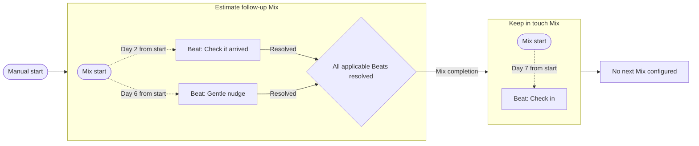

# Journey: the account's Mix and Beat graph

**Implementation follow-up:** see [the implementation and verification record](JOURNEY_IMPLEMENTATION_2026-09-21.md) for delivered behavior and tested limits. The analysis below records the earlier evaluation and recommendations.

September 21, 2026. Analysis and implementation proposal, revised after the owner's clarification. No application behavior, schema or deployment changed in this review. The product direction below is the owner's requirement; execution, layout and measurement details are recommendations unless explicitly identified otherwise.

**Owner's clarified direction:** Journey is a dynamic node diagram of all the Mixes and Beats belonging to the account, their connections, and contacts' progression through them. It must make strong and weak connections, missing Beats and dead ends apparent at a glance. Lead, Prospect, Client and Retention must not determine its primary structure. This supersedes the initial proposal's stage-centered map and the stage-centered Journey composition in the supplied export. Preserve the original export; retain its shared visual language where applicable.

The requested outcome is one setup that keeps each contact moving through connected Mixes automatically, with Journey explaining the configured route, current progress, recorded results and anything preventing the next step. Existing stage automation remains compatible background behavior; no stage setup is required to use this graph.

The subsequent [forensic experience review](JOURNEY_EXPERIENCE_FORENSIC_REVIEW_2026-09-21.md) and [acceptance matrix](JOURNEY_EXPERIENCE_ACCEPTANCE_2026-09-21.csv) trace the concept across the platform. The owner's further clarification makes multiple triggers, concurrent paths, conditional decisions and loops core scope. The [dynamic workflow contract](JOURNEY_DYNAMIC_WORKFLOW_CONTRACT_2026-09-21.md) defines their proposed semantics and governs where this initial handoff proposal is less specific. All topology and outcome choices come from the account's saved configuration. The owner's estimate example is illustrative only, never a fixed implemented flow. Execution details remain recommendations unless recorded as owner decisions.

## Findings from the current workspace

| Area | Verified current behavior | Implication |
| --- | --- | --- |
| Mix editor | `MixEditor.tsx` offers date, manual and fixed-date starts. `MixTriggerMode` contains only those three choices. | A completion start requires persisted configuration, server validation and scheduler support. |
| Stage automation | `journey.ts` supports `PLAN_COMPLETED` for the current stage's managed assignment. Entry into another stage can assign an active manual Mix. | Some stage-to-stage chaining exists; direct Mix-to-Mix chaining does not. |
| Completion | Maintenance compares active Mix steps against DONE/SKIPPED steps completed since stage entry. Appointment-bound follow-ups are excluded. | This is not a general completion definition for one exact execution, especially after repeats or edits. |
| Outcomes | The outcome endpoint marks no answer, voicemail, wrong number and rescheduled as DONE as well as completed/connected. | Finishing a sequence does not demonstrate successful contact, a sale or completed work. |
| Execution identity | Assignments can be reused; manual scheduling uses the local start date in its occurrence key. Jumps have no explicit `MixRun` relation. | Two runs on the same day and precise parent/child ownership need explicit identities. |
| Journey | The current structure is stage-centered. Lead/Prospect/Client/Retention are editable starting stages, not hardcoded immutable names. Arrows aggregate recorded stage moves over 30 days; touchpoint links reflect member stages; stage-managed Mixes are excluded from the independent touchpoint query. | Renaming stages cannot satisfy the request. Replace the graph's primary data model with actual Mixes, Beats and configured relations. |
| Beat timing | Ordinary Beats are scheduled relative to a Mix's start; the scheduler does not generally wait for the preceding Beat to be completed. | A visual sequence must distinguish scheduled timing from a true completion dependency. |
| Performance evidence | Outcomes, attempts, stage events and automatic delivery records exist, but there is no general Beat-to-Beat or Mix-to-Mix transition ledger. | Derive only supported measures initially; add exact run/handoff evidence for reliable progression rates. |
| Map size | The map shows at most six touchpoints, with the complete list separately available. | A roadmap cannot silently omit an intermediate Mix in a selected chain. |
| Undo | The Today completion control offers Undo for ten seconds. | Immediate downstream effects need cancellation and a server-side grace period. |

Sources reviewed: [journey behavior](CUSTOMER_JOURNEY_AND_CONNECTIONS.md), [September 18 audit](UI_UX_PRODUCT_READINESS_AUDIT_2026-09-18.md), [September 20 design follow-through](design/DESIGN_FOLLOWTHROUGH_2026-09-20.md), [activation decisions](design/QUICK_ADD_AND_ACTIVATION_2026-09-20.md), [quiet-day decisions](design/QUIET_DAY_TOUCHPOINTS_2026-09-20.md), current application source and tests. These describe the local workspace; deployment history is not evidence that every current workspace change is live.

## Recommended setup experience

Add **After someone finishes another Mix** under **When should it start?**

Show a searchable **Which Mix?** selection and optional **Wait before starting** control, defaulting to no added delay. Present a compact editable summary:

> After a person finishes Estimate follow-up, start Keep in touch for that same person.

The completion rule inherits the individual who finished the source run. It must not require choosing the audience again, adding a tag, moving a stage, or pressing Start for each person. For this rule, show “People who finish [source Mix]” in place of Everyone/tag enrollment controls. Retain separately configured audience starts for the destination where compatible. Any later optional audience restriction on the completion rule must narrow that inherited audience, never enroll an entire group when one person finishes.

Activation means **Turn on this connection**. It creates no immediate audience enrollment and starts no historical completions. Preserve the owner's existing review-before-activation preference for enabling the connection; it does not introduce a review at every handoff. Show the source, destination, delay, completion policy and sending behavior in the activation review. A connection can be drafted before it is usable, with a visible reason if its source or destination is unavailable.

Both the editor and Journey edit the same saved connection. Selecting a Mix in Journey provides **Connect next Mix**, opening a prefilled destination chooser. Selecting a Beat opens its existing timing/content editor; **Add Beat** opens that editor within the owning Mix. Creating or selecting a destination should retain the context and return to the selected route. No separate automation setup must be required after saving the Mix. Drawing a connection, if later supported, must configure and validate its actual trigger before activation.

Example configuration, not seeded production data:

Mixes are containers and Beats are real nodes inside them. Start/finish markers explain conditions; they are not invented Beats. The example's day-based links show schedule relationships, not an unsupported “Beat 2 waits until Beat 1 finishes” rule. An independent birthday Mix forms its own connected component, with its date trigger visible. Contact stages may appear as optional metadata or actual configured event conditions; finishing follow-ups never implies that a sale occurred.

## Journey as the account graph

Build the graph from all account-owned Mix definitions and their Beat memberships, before overlaying contacts or history. Account-owned copies of library Mixes belong here; unselected library templates do not. Include active, draft, paused, standalone and stage-managed Mixes, with explicit status. Retain archived Mixes and retired Beats in a discoverable history filter, especially where runs or connections still refer to them. Account-owned System/one-time items remain discoverable in clearly labeled groups even when they cannot participate in new handoff authoring. Visibility and trigger eligibility are separate decisions. Empty and unused Mixes must remain visible because they may be setup gaps. Show account totals and any filtered/collapsed counts so the scope is explicit. Quiet-day suggestions can be a separately labeled optional overlay; they are not fabricated Mixes or Beats.

Use a directed compound graph: Mix containers, Beat nodes, explicit entry triggers, finish conditions and connections. An overview summarizes each Mix's Beat rhythm and health; zooming in or expanding reveals every Beat and its actual relationship. Use one canonical Mix identity with several incoming/outgoing edges, avoiding duplicate nodes that imply duplicate plans. Reused wording/template versions do not themselves create connections. Pipelines emerge from configured connected components; there is no fixed set or fixed number of pipeline stages.

Every edge has a visible meaning: scheduled timing, a completion dependency, an event condition, a conditional/parallel route, a wait/join, a return, or a Mix handoff. Label timing against its actual anchor, such as “Day 7 from start” or “30 minutes after appointment.” Keep configured edges present with zero traffic. Historical traversals and performance decorate those edges; they never determine whether the relationship exists. Beat-to-Mix and Beat-to-Beat connections are part of the requested model and require executable rules in the same evaluator. No connection can be inferred merely from visual proximity.

Keep the shared semantic tokens and Instrument Sans. Use deterministic automatic layout with stable node identifiers, fit-to-view, pan/zoom, search and focus-on-path. Refreshing counts must not rearrange the diagram. Branches and disconnected components remain apparent; collapse large areas with explicit counts and expand controls. Never silently truncate to six Mixes or omit a Beat in a focused route. Keep system status separate from performance: a paused node is not evidence of weak results.

Selecting a node or edge opens details: trigger, timing, real counts, people waiting, performance evidence and relevant edit actions. Selecting a contact highlights completed, active and conditional future nodes. A contact can have several active Beats/Mixes at once; display that concurrency rather than forcing one position. Future steps remain conditional, with no invented date before an anchor is known. The contact timeline explains actual handoffs and interruptions.

Use one graph with **Setup**, **Progress** and **Results** display modes, preserving positions and selection. Setup emphasizes connectivity and missing configuration; Progress shows actual work/waits; Results shows the selected recorded metric. A person filter works across these views. Recent activity is a details/history panel rather than a competing primary diagram.

On phones, lead with the selected Mix/path and a compact issues summary. Offer the same graph and an equivalent structured list of Mixes, Beats, branches and connections, with the existing details sheet pattern. Preserve keyboard navigation between connected nodes, visible focus and reduced motion. Pair performance color with text, icons and numbers, following [WCAG's use-of-color guidance](https://www.w3.org/WAI/WCAG22/Understanding/use-of-color.html). Keep controls and the list readable at narrow widths; the [reflow guidance](https://www.w3.org/WAI/WCAG22/Understanding/reflow.html) treats necessary two-dimensional diagrams separately from the surrounding interface.

Refresh affected data after saves/outcomes and on tab focus. While Journey is visible, poll a lightweight workspace revision/status endpoint, initially around 10–15 seconds, with backoff on failure. Refresh only when the revision changes and preserve selection, filters, scroll, drafts and Undo. Show stale/processing state truthfully. Browser refresh displays progress; the worker must advance the contact while the browser is closed.

## Strong and weak connections: make the measure explicit

Use actual recorded evidence at both Beat and connection level. Traffic volume, reliable progression, completion of work and customer outcomes are different measures; a busy line or many DONE records does not establish successful results. The user selects a metric and period; the legend states the comparison. Do not introduce an unexplained combined health score.

| Measure | Definition and display |
| --- | --- |
| Beat handling | For the due Beat executions in the selected cohort, show completed, skipped, overdue and still pending separately. Include counts and the number evaluated. Timely handling uses the saved due deadline; preserve original/rescheduled deadlines for audit. |
| Scheduled Beat progression | Show which Beat executions were reached/prepared within the same run. Label this as scheduled progress; it does not prove the preceding Beat caused the next one. |
| Mix handoff reliability | For eligible handoffs whose delay and stated observation allowance have elapsed, show started/eligible plus waiting, blocked, canceled and already-running dispositions. Apply explicit exclusions with their counts; a not-yet-due handoff is not a failure. |
| Recorded engagement | Show supported outcomes such as a connected call. Message handoff, copying text or provider acceptance cannot supply a reply rate. Missing observation is “Not tracked,” not zero. |
| Recorded goal outcome | Only show bookings/sales or another outcome when an actual configured goal and run-linked evidence exist. State the attribution window and observed count; do not imply causation. Record an attribution policy before aggregating overlapping Mixes. |
| Waiting and delay | Show people/Beat executions waiting past their configured due time, their age and the concrete blocker. An intentionally long interval is not automatically a weak link. |

“Strong” and “Needs attention” badges should refer to a visible configured target or a comparable historical baseline for that same metric. With no target/comparable baseline, display the raw measure without judgment. Keep new/low-volume connections neutral with “Not enough data.” Comparison qualification and minimum evidence are transparent product settings, not fabricated industry benchmarks. Counts and percentages remain visible on hover/focus and in the detail panel; the overview labels only the most relevant metric to avoid clutter.

Use the same source cohort for a connection's numerator and denominator. Record whether the unit is people, runs or Beat executions; repeated runs cannot silently inflate a “people” rate. Separate immature cohorts from evaluated ones, retain configuration/Beat revisions, and revise projections after Undo or correction. Compare like-for-like windows and versions. Show the last refresh time and data availability. Existing historical records without reliable run attribution get descriptive outcome totals only, not reconstructed transition percentages.

Recommended visual encoding: optional line width represents observed traversal volume; labeled badges/icons represent performance against the chosen comparison; separate warning markers represent invalid setup or blocked execution. Never equate width with success. Selecting a weak edge reveals the exact affected contacts and the recorded reason, with actions such as Edit Beat, fix the start condition, or reconnect the next Mix.

## Missing Beats and dead ends

Run a read-only graph analysis after saves and on the current graph snapshot. Each finding names its node/edge, evidence, severity and fix. Offer **Add Beat**, **Connect next Mix**, **Fix trigger**, **View waiting people**, or **Mark intentional end** in context. Findings never insert Beats, enroll contacts or enable automation without an explicit save.

| Finding | Interpretation |
| --- | --- |
| Mix contains no runnable Beats | Concrete setup gap, including a Mix whose only Beats were retired. |
| Missing required content/timing/anchor or unavailable referenced Mix | Concrete configuration problem; identify exactly what is missing. |
| No incoming connection | Show the entry trigger. A valid manual/date/event entry is a legitimate root; no trigger and no incoming route is an unreachable component. |
| No outgoing connection | Label “No next Mix.” An owner can mark it as an intended finish. Only flag an unresolved endpoint as a possible dead end; finishing is often correct. |
| Contact stranded | No active/pending work, no future date/appointment/event to wait for, no applicable next route and no recorded intentional finish/stop. Show this as an operational issue rather than treating every quiet contact as stranded. |
| Large timing gap | Show the actual gap and compare only with an explicit configured expectation. A monthly or annual rhythm is not inherently missing a Beat. |
| Missing business step | A suggestion requires an owner-defined goal/checklist or explicit expected next action. Topology alone cannot prove that a sales call, thank-you or other particular Beat should exist. |
| Unguarded cycle or conflicting route | Allow deliberate loops with progress boundaries, iteration identity and an exit policy. Block repeated consumption of the same event without progress; explain conflicting routes or timing. |

Persist intentional-end/entry expectations as configuration. Keep real failures visible even when a nearby endpoint is marked intentional. Drafts may show incomplete setup without being counted as production failures. A performance concern and a setup defect may appear on the same node but retain their separate explanations.

## Proposed execution contract

| Situation | Recommended behavior |
| --- | --- |
| Source finishes | Evaluate one specific run and instance for one contact. Apply the saved choice or parallel routing rule once; all outgoing lines do not automatically mean parallel execution. |
| All applicable Beats completed or explicitly skipped | A simple finite sequence can finish under its configured skip policy. For branching runs also resolve required decisions, waits, joins and finish conditions; unselected alternatives do not block completion. Preserve the outcome breakdown without inferring business success. |
| Source paused, stopped, canceled or contact archived | Do not treat it as completion. A stopped run cannot start a successor. |
| Beat waiting outside the scheduling horizon | The run is still incomplete. Absence of prepared pending Jumps is insufficient. |
| Rescheduled Beat | Track its replacement commitment within the run and wait for resolution. This needs an explicit change from today's DONE representation; exclude unsupported reschedule cases until implemented. |
| No answer or voicemail | The recorded attempt can finish its Beat; no sale/conversation is inferred. |
| Wrong number or unavailable destination channel | Retain the outcome and show the destination's concrete eligibility problem. Do not silently claim the next outreach is ready. |
| Duplicate completion or worker retry | Reuse the recorded handoff result; never create another destination run. |
| Destination already running for that contact | Deduplicate the same logical admission/visit without taking over its ownership. A separate work instance or configured repeat can have its own run; contact plus Mix alone is not a duplicate key. Explain any configured singleton hold. |
| Source finishes again in a later legitimate run | Evaluate a new admission with its own instance/iteration identity, including repeats on the same date. Do not reuse an earlier completion or suppress independent work merely because it uses the same Mix. |
| Connection enabled or edited | Apply to qualifying completions from that point forward. Do not scan historical completions into enrollment. Existing reserved handoffs retain their recorded connection revision unless canceled. |
| Destination/connection paused during a delay | Hold the handoff visibly; recheck eligibility on resume. Archived destinations and deleted connections cancel it. Manual stops and Do not contact must never be automatically overridden. |
| Undo before handoff starts | Reopen the source and invalidate its pending handoff atomically. |
| Reopening after handoff starts | Cancel untouched child work owned by this handoff where safe. Preserve sent/performed work and independent runs, stop further dependent progression and explain any partial reversal. |

Use a server-enforced grace period covering the existing ten-second Undo opportunity before releasing a user-completed handoff. Show “Next Mix queued” immediately. If a completion response is delayed, the response must expose the authoritative undo deadline; the UI must not promise a fresh ten seconds beyond what the server can honor. Automatic deliveries do not need the user-click grace period, but retain their established review/send rules.

No-added-delay means the new run becomes eligible after this grace period and processing. It does not promise an instant message. Day-zero Beats must never be scheduled before the actual destination start. Calendar-day delays use the saved workspace timezone, including daylight-saving changes; Beat times, quiet hours, weekend rules and existing automatic-send preferences remain effective.

Preserve the current meaning of the Journey pause: it pauses stage movement and leaves already-running Mixes in place. Give a connection and a contact's chain their own pause controls, with explicit scope. Do not silently convert “Automatic transitions paused” into a global messaging pause.

## Implementation architecture

Extend the existing Prisma/PostgreSQL scheduler and durable `Job` worker. The first release does not need a separate workflow service or a general drag-and-drop builder.

1. **Saved connections and entry rules.** Add a completion start choice backed by one canonical saved rule containing workspace, source and destination, enabled state, delay, revision and activation time. Separate admission from Beat timing and preserve compatible manual/date/stage starts. Add explicit choice, parallel, wait, join and return semantics as specified in the dynamic workflow contract. A `MixConnection` may represent a completion rule; avoid duplicate editor/graph configuration. Qualifying branches and loops is core delivery scope, not an optional later feature.
2. **Exact executions.** Add a work-instance identity carried through `MixRun`, Beat executions, decisions and handoffs. Record workspace/contact/Mix, unique occurrence/iteration, state, revision and ownership. Associate prepared Jumps with exact run-level Beat obligations. Track applicability as branches are selected; unselected branch Beats are not unfinished obligations. Include required future Beats outside the scheduling horizon and event waits. Preserve earlier loop visits and deadline/outcome changes. Version definitions for future runs; adopting changes into running work requires reviewable reconciliation.
3. **Durable handoffs.** Add `MixHandoff` with source execution/visit, connection revision, destination run, eligibility time, state and reason. Use a unique logical admission key including instance and visit/iteration where needed. A source-run/connection pair suffices only for a once-per-run finish route, not every Beat-level loop. Event replay must not create another child; corrections invalidate obsolete work without overwriting previous visits.
4. **Shared completion service.** Call it from the outcome API, legacy status action and automatic-delivery completion path. It checks all applicable run members, records completion and queues processing in the same transaction. A worker reconciliation pass catches interrupted/legacy paths. Provider handoff, scheduled time and opening a message are not completion evidence.
5. **One transition evaluation.** Apply explicit business milestones before completion continuations from the same action. If a connected call moves someone out of a stage, do not launch an obsolete continuation for that old stage. Route stage `PLAN_COMPLETED` rules through the same run evidence as Mix connections. Define ordering in one service so independent handlers cannot race to enroll the person twice.
6. **Ownership and eligibility.** Carry the original stage-entry ownership through its whole chain. Stage exit cancels only work owned by that stage entry, preserving independently assigned and appointment-owned work. Current `managedAssignmentId` alone is insufficient for descendants. Scope all reads/writes by workspace and recheck stops, contact state and destination state at execution time.
7. **Shared account graph.** Project every in-scope Mix and its actual Beat memberships, start anchors, completion conditions and saved connections into a typed graph. Existing stage rules contribute explicit event/entry edges or optional metadata; they do not supply the primary nodes or layout. Derive scheduled timing edges from the saved timing configuration without inventing completion gating. Reuse the projection in Journey, Mix sidebars and contact explanations. Keep graph topology separate from layout coordinates, contact execution overlays and metric projections.
8. **Diagnostics and results.** A graph validator supplies structural findings from configuration; execution projections supply waiting/blocker findings; metric aggregations supply cohort/period/version-qualified results. Store intentional endpoints and optional goal/target expectations explicitly. Maintain a minimal event ledger of run, Beat and handoff transitions, with occurrence/configuration IDs and correction references, so analytics do not count retries or undone outcomes twice. Batch counts with indexed grouped queries and cache by workspace/configuration/data revision; avoid querying once per node on every poll. Do not expose private message wording or notes in account-wide performance summaries.

Use short transactions, a consistent workspace/contact/run lock order compatible with current journey code, database uniqueness and retry handling. Persist the worker job with the completion event so a crash cannot leave a finished source without work queued. These are design recommendations using PostgreSQL's documented [row locking and deadlock behavior](https://www.postgresql.org/docs/current/explicit-locking.html#LOCKING-ROWS); network/provider calls remain outside the lock-holding transaction.

Validate loops at save and activation, including cycles spanning legacy stage routes. Permit deliberate repeats with a new event, future timer or bounded progress condition and explicit exit behavior. Reject cycles that can autonomously consume the same unchanged event forever. Keep bounded worker evaluation and an explained hold as a second line of defense.

Implementation touchpoints:

| Current code | Required change |
| --- | --- |
| [Mix editor](../src/components/MixEditor.tsx) and [save action](../src/lib/mix-editor-actions.ts) | Persist the new trigger, inherited audience and connection review; validate graph, timing and eligibility on the server. |
| [Core schema](../prisma/schema.prisma) and [journey schema](../prisma/customer-journey.prisma) | Add run/handoff/connection identities and stage-entry ownership through additive migrations. |
| [Jump engine](../src/lib/jump-engine.ts) | Use explicit trigger dispatch: its current final `else` treats remaining modes as manual starts. Generate and reconcile completion-triggered Beats only from an eligible run; do not accidentally enroll audiences or cancel a child as stale legacy work. |
| [Outcome endpoint](../src/app/api/jumps/[jumpId]/outcome/route.ts), [status action](../src/lib/jump-status-actions.ts), [automatic delivery](../src/lib/automatic-delivery.ts) | Share completion/reopening evaluation and commit durable follow-on work with status changes. |
| [Journey engine](../src/lib/journey.ts) and [worker](../src/worker/index.ts) | Coordinate stage movement, chain ownership, handoff dispatch and retry reconciliation. |
| [Journey page](../src/app/(app)/journey/page.tsx), [map](../src/components/JourneyMap.tsx), [layout](../src/lib/journey-map-layout.ts) | Replace the stage-statistics graph with a compound Mix/Beat graph, stable automatic layout, full selected paths, diagnostics/results overlays and revision-driven refresh. |
| [Contact profile projection](../src/lib/contact-profile-view.ts) | Reuse run identity and explain actual/conditional next steps consistently with Journey and Today. |

## Delivery sequence and acceptance

1. **Graph foundation and structural view:** define the typed Mix/Beat graph and project all existing account configuration, including disconnected components and timing semantics. Build the compound layout and equivalent list, zero-traffic visibility and deterministic setup checks. Existing stages cease to determine Journey's composition. This supplies immediate truthful setup visibility before new handoff execution is enabled.
2. **Execution foundation and connection authoring:** additive schema, precise instance/run/Beat/iteration identity, shared evaluation, durable handoffs/timers, pause/Undo and retry semantics; then completion starts, decisions, parallel paths, joins and guarded loops. Use inherited contacts, activation previews and shared editor/Journey configuration. Preserve legacy scheduling and backfill only provable identities; ambiguous history cannot trigger retroactive work. A finite linear pilot may validate the foundation but does not fulfill the owner's complete scope. Internal system/one-time work remains visible with its actual authoring eligibility.
3. **Progress and results:** live Beat/run/handoff state, contact-path highlighting, actionable blocked/dead-end findings, cohort-correct metric overlays and honest insufficient/unavailable-data states. Strong/weak comparisons and missing-Beat detection are part of the requested release acceptance, not optional decoration.
4. **Existing trigger integration:** qualify date, appointment and broadcast rules alongside completion and outcome connections. A recurring date completes one occurrence; a broadcast completes per recipient. Never wait for every contact to finish a whole Mix. Visibility of all existing account Mixes and Beats is required from phase 1; temporary execution restrictions must be disclosed as incomplete scope.

Acceptance requires an end-to-end A → B → C chain for the same contact with no per-handoff action; retries and concurrent completions create one child; two distinct same-day runs remain distinct; skips, cancellations, long horizons, rescheduling and Undo follow the contract; an intervening milestone cancels only the stage-owned route; pauses and contact restrictions remain effective; and a delayed handoff survives a worker restart and executes with the browser closed.

Verify both activation preferences, drafts and failed saves, zero-contact setup, an intentional endpoint, unavailable destinations, no journey stages configured, chains longer than six Mixes, branches, tenant boundaries, and realistic account sizes. Journey works immediately from existing account Mixes/Beats without stage setup. A Mix with no configured start, a legitimate manual root, a scheduled annual root and an intentionally finished chain must receive distinct diagnoses.

Graph acceptance also requires all Mix/Beat definitions to remain reachable through clear scope controls; multiple concurrently active Beats to be represented faithfully; data refresh without layout jumps; edge selection showing actual source/destination rules; and repair actions that edit the same configuration the worker executes. A chronological Beat line must never imply an unsupported completion dependency.

Results acceptance requires fixtures covering mixed outcomes, skipped versus completed Beats, zero traffic, no tracked reply data, immature cohorts, overdue versus intentional waits, retries/Undo, repeated runs, concurrent Mixes, changed Beat versions and different sample sizes. Verify every numerator/denominator against the fixture ledger and disclose exclusions. A high-volume low-success edge must not appear strong simply because its line is wide, and a new edge must not appear weak simply because it has no outcomes.

Compare shared visual language against the supplied light/dark phone, portrait-tablet and desktop exports; compare the new Journey composition against the owner's clarified Mix/Beat graph requirements, not the superseded stage-circle structure. Check keyboard use, narrow-screen reflow, readable edge labels, current-contact selection, stale data and the real completion-to-next-Mix workflow. Run schema/migration checks, relevant integration/browser tests, typecheck and build. Qualify unattended processing on the stable test site `https://jump-in-the-mix-test.netlify.app/`, using explicit site ID `8fd20ccd-5c35-47e5-99ce-98e5670d52fe` for any authorized staging deployment.

## Verification performed for this analysis

Read the relevant supplied light/dark Mix and Journey exports, prior decision records, execution paths and data models. Ran existing `journey-map-layout`, `journey-view`, `contact-profile-view` and `jump-schedule` suites: **4 files, 18 tests passed**. These establish a limited baseline only; completion chaining has not been implemented or tested. No application build or deployment was performed for this documentation-only proposal.

For the owner's subsequent graph clarification, reviewed the scheduler's actual Beat timing and the outcome/attempt/delivery schemas, revised this proposal and recorded the new design direction. The 18-test result above belongs to the initial analysis; it does not validate the proposed replacement graph or performance calculations. This revision was checked for valid local document links and whitespace only.
